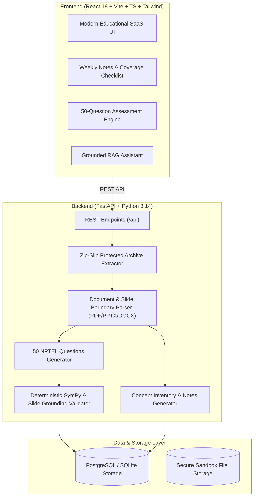

# NPTEL_Assistant 🎓
> **An Intelligent Weekly Study Notes and NPTEL-Style Practice Platform**
> Grounded strictly in uploaded course lecture slides and materials.

---

## 🌟 Executive Overview

**NPTEL_Assistant** is a production-minded web application designed for students preparing for weekly university and NPTEL examinations. Students upload a single ZIP archive containing course lecture documents (PDFs, PPTX presentations, DOCX handouts, or Markdown notes). 

The platform extracts, organizes, and processes materials on a week-by-week basis to produce:
1. **Comprehensive Weekly Short Notes** with concept coverage checklists, KaTeX formulas, tables, and exact slide citations.
2. **Exactly 50 NPTEL-Style Practice Questions per Week** adhering to strict difficulty targets (10 Easy, 25 Medium, 15 Advanced) across single-choice, multiple-choice, and numerical formats.
3. **Strict Lecture-Slide-Only Grounding** preventing hallucinations and external knowledge contamination.
4. **Interactive Mock Test Engine** with timed/untimed modes, 50-question navigation palette, autosave, in-depth solution reviews, and incorrect question retries.
5. **Grounded RAG Assistant ("Ask AI")** scoped strictly to weekly lecture slides.
6. **Progress Analytics & Weak Concept Diagnostics** tracking mastery across difficulty tiers.

---

## 🏛️ System Architecture



---

## 🎯 Two Core Non-Negotiable Requirements

### Requirement A: Comprehensive Weekly Short Notes
- **Concept Inventory First:** Analyzes all lecture slides in the week to extract all principles, definitions, equations, algorithms, and comparisons.
- **Formulas & Math:** Rendered safely with LaTeX / KaTeX (e.g. Amdahl's Law, CPU clock equations, MIPS throughput).
- **Misconception Traps:** Highlights subtle conceptual traps frequently tested in NPTEL assessments.
- **Coverage Checklist:** Displays a verified concept inventory with exact lecture and slide provenance.
- **Export & Editing:** Supports inline editing, section-level AI regeneration, Markdown export, and clean PDF printing.

### Requirement B: Exactly 50 Practice Questions (Strict Slide-Only Policy)
- **Target Distribution:** Exactly 50 distinct validated questions:
  - **10 Easy:** Direct definitions and basic pipeline stage roles.
  - **25 Medium:** Hazard dependencies, forwarding paths, Amdahl speedups.
  - **15 Advanced:** Multi-step numerical calculations and architectural state analysis.
- **Question Formats:** Single-correct MCQ, Multiple-correct MCQ, and Numerical problems with deterministic validation.
- **Strict Lecture-Slide-Only Policy:** Questions must be solvable **only** from that week's uploaded slides. Never introduces ungrounded external facts or cross-week knowledge.
- **Shortage Reporting:** If slides do not contain sufficient content for 50 valid questions, the platform reports the shortage explicitly rather than fabricating questions.

---

## 🚀 Quickstart Guide

### Prerequisites
- **Node.js** (v18+ or v22+)
- **Python** (3.10+)

---

### Step 1: Start the Backend (FastAPI)

```bash
cd backend

# 1. Activate the Python virtual environment
source venv/bin/activate

# 2. Run automated tests to verify security & grounding
PYTHONPATH=. pytest tests/ -v

# 3. Start the FastAPI development server
PYTHONPATH=. uvicorn app.main:app --host 0.0.0.0 --port 8000 --reload
```
- API Documentation (Swagger UI): **`http://localhost:8000/docs`**
- Health Check: **`http://localhost:8000/health`**

---

### Step 2: Start the Frontend (React + Vite)

Open a new terminal window:

```bash
cd frontend

# 1. Start the Vite dev server
npm run dev -- --host 0.0.0.0 --port 5173
```
- Web Application: **`http://localhost:5173/`**

---

## 🧪 Automated Test Suite

Run the test suite inside the `backend/` directory:

```bash
cd backend
source venv/bin/activate
PYTHONPATH=. pytest tests/ -v
```

### Verified Test Cases:
| Test File | Verified Feature | Status |
| :--- | :--- | :--- |
| `tests/test_archive.py` | Safe ZIP extraction & decompression bomb defense | ✅ PASSED |
| `tests/test_archive.py` | **Zip-Slip path traversal attack rejection** | ✅ PASSED |
| `tests/test_grounding.py` | Strict slide-only source grounding validation | ✅ PASSED |
| `tests/test_grounding.py` | Rejection of ungrounded external document citations | ✅ PASSED |
| `tests/test_grounding.py` | **Deterministic SymPy numerical evaluation** | ✅ PASSED |
| `tests/test_grounding.py` | Duplicate & near-duplicate question detection | ✅ PASSED |
| `tests/test_notes_and_questions.py`| Concept inventory coverage checklist (100%) | ✅ PASSED |
| `tests/test_notes_and_questions.py`| **Target of 50 questions (10 Easy, 25 Med, 15 Adv)** | ✅ PASSED |
| `tests/test_notes_and_questions.py`| Honest shortage warning report on empty slides | ✅ PASSED |

---

## 🐳 Docker Compose (Production / Local Stack)

To run the complete stack including PostgreSQL:

```bash
# Start PostgreSQL, Backend, and Frontend in Docker
docker compose up --build -d

# Check status
docker compose ps
```

---

## 📂 Project Directory Structure

```text
NPTEL_Assistant/
├── frontend/                     # React 18 + Vite + TypeScript
│   ├── src/
│   │   ├── components/           # Reusable UI (FormulaRenderer, Header, Sidebar)
│   │   ├── features/
│   │   │   ├── dashboard/        # Dashboard overview & course metrics
│   │   │   ├── upload/           # Drag-and-drop ZIP upload & 10-stage pipeline status
│   │   │   ├── courses/          # Course workspace & week overview cards
│   │   │   ├── notes/            # Weekly short notes & concept coverage checklist
│   │   │   ├── questions/        # 50 practice questions bank & slide grounding tags
│   │   │   ├── quizzes/          # Interactive mock test engine & question palette
│   │   │   ├── chat/             # Grounded RAG study assistant ("Ask AI")
│   │   │   ├── progress/         # Performance analytics & weak areas diagnostic
│   │   │   └── settings/         # Preferences & AI provider configuration
│   │   ├── services/             # API client & realistic mock fixtures
│   │   └── types/                # Domain TypeScript definitions
│   └── package.json
│
├── backend/                      # Python FastAPI application
│   ├── app/
│   │   ├── api/endpoints/        # Courses, notes, questions, quizzes, chat, upload
│   │   ├── core/                 # Config & settings
│   │   ├── database/             # SQLAlchemy engine & session factory
│   │   ├── models/               # Relational database models
│   │   ├── schemas/              # Pydantic schemas
│   │   └── services/
│   │       ├── document_processing/  # Zip-Slip archive extractor & slide parsers
│   │       ├── notes_generation/     # Concept inventory & weekly notes generator
│   │       ├── question_generation/  # 50 NPTEL questions generator & slide grounding
│   │       └── validation/           # SymPy numerical checker & duplicate detector
│   ├── tests/                    # Pytest test suite
│   ├── requirements.txt
│   └── Dockerfile
│
├── docker-compose.yml            # Multi-container Docker deployment
├── .env.example                  # Environment template
└── README.md                     # Comprehensive documentation
```

---

## 🔒 Security & Privacy Guarantees
- **Zip-Slip Protection:** Path traversal patterns (e.g. `../../etc/passwd`) are strictly validated and blocked using canonical path evaluation.
- **Decompression Bomb Defense:** Limits both total decompressed bytes (250 MB max) and extracted member count (200 files max).
- **File Type Whitelist:** Rejects executable binaries, processing only `.pdf`, `.pptx`, `.docx`, `.txt`, and `.md`.
- **Zero Hallucination Guarantee:** The validation pipeline verifies every question's citations against that week's source chunks before committing to the question bank.
